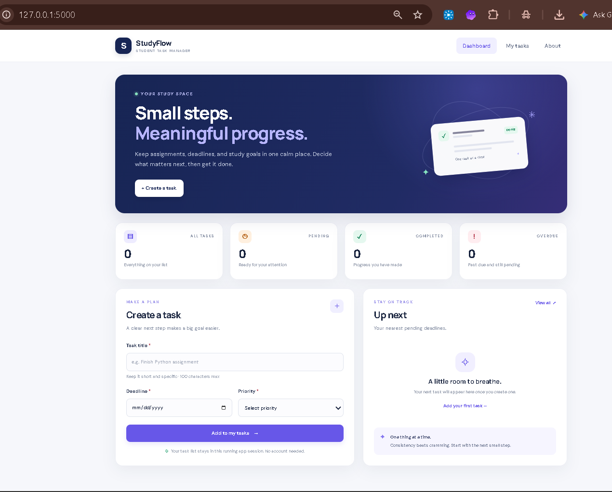
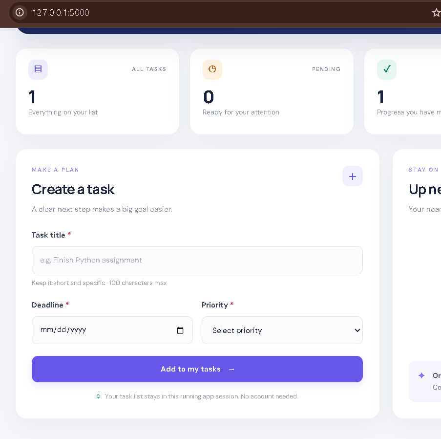
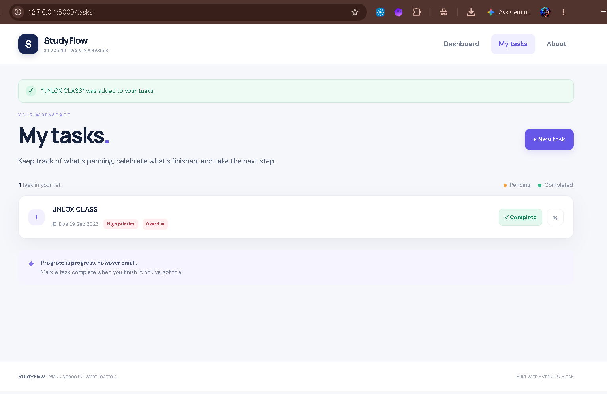
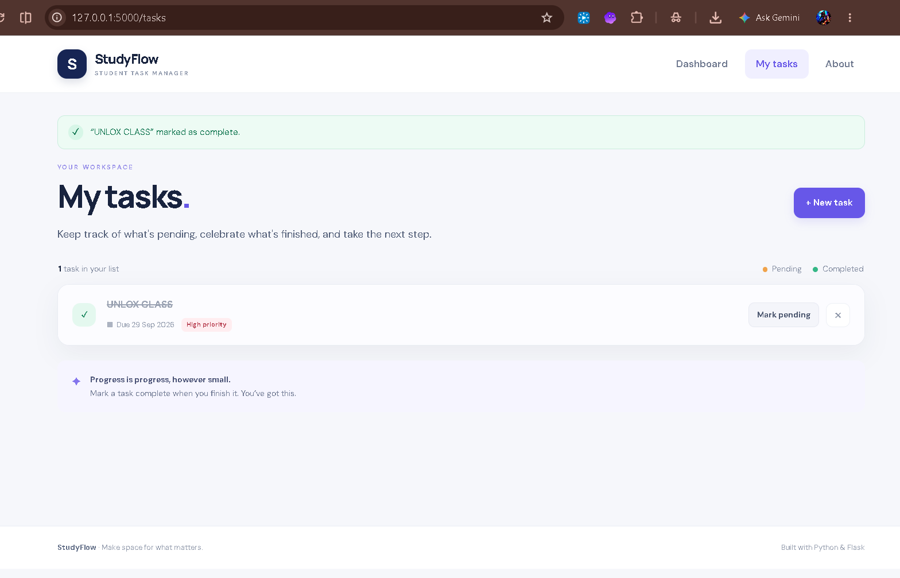
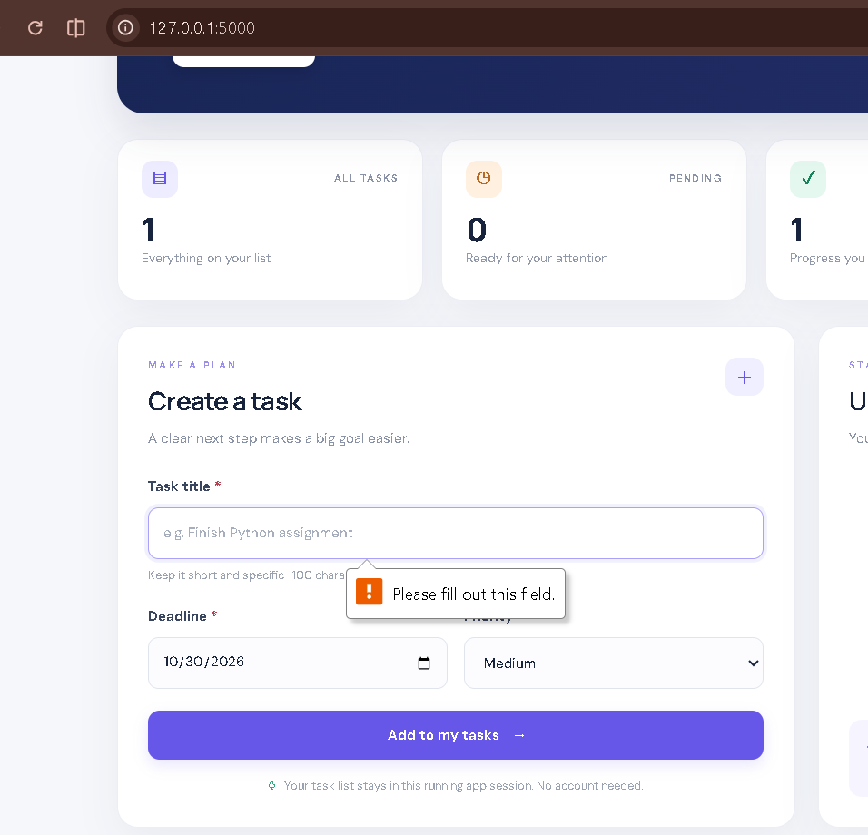
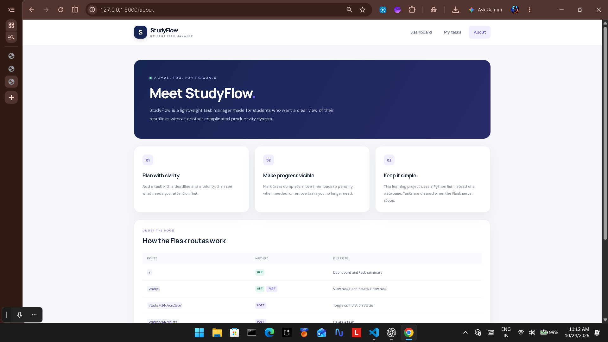

# 🎓 StudyFlow — Student Task Manager

**Python Flask Mini Project**
👨‍💻 **Author:** BHOLA SANKAR MAJHI

## 📌 Project Overview

StudyFlow is a beginner-friendly web application developed using Python and Flask to help students organize their academic tasks. Users can add tasks, assign deadlines and priorities, mark tasks as completed, and delete tasks.

This project demonstrates fundamental web development concepts, including Flask routing, GET and POST requests, HTML templates, CSS styling, form handling, and server-side input validation.

## ✨ Features

* 📊 Dashboard with task statistics.
* ➕ Add tasks with deadlines and priorities.
* 🎯 Low, Medium, and High priority levels.
* ✅ Mark tasks as completed or pending.
* 🗑️ Delete tasks.
* 🛡️ Server-side input validation.
* ⚠️ Friendly error and success messages.
* 📱 Responsive web interface.
* 🔒 CSRF protection for state-changing forms.

## 🛠️ Technologies Used

* Python
* Flask
* HTML5
* CSS3
* Jinja2 templates
* Git and GitHub
* Visual Studio Code

## 📁 Project Structure

```text
student-task-manager/
├── app.py
├── README.md
├── requirements.txt
├── .gitignore
├── templates/
│   ├── base.html
│   ├── index.html
│   ├── tasks.html
│   ├── about.html
│   └── error.html
├── static/
│   └── css/
│       └── style.css
├── tests/
│   └── test_app.py
└── screenshots/
    ├── 01_homepage.png
    ├── 02_task_form.png
    ├── 03_task_created.png
    ├── 04_task_completed.png
    ├── 05_validation_error.png
    └── 06_about_page.png
```

*Note: Keep the screenshots folder beside README.md and app.py. Do not upload the `.venv` folder.*

## 💻 Development Environment Setup

### 1. Install Python

Download Python from:

https://www.python.org/downloads/

Verify the installation in PowerShell:

```powershell
py --version
```

### 2. Install Visual Studio Code

Download VS Code:

https://code.visualstudio.com/

Open the folder containing `app.py`, `README.md`, and `requirements.txt`.

Open the integrated terminal using **Terminal → New Terminal**.

### 3. Install Git

Download Git:

https://git-scm.com/downloads

Verify the installation:

```powershell
git --version
```

## 🚀 Installation and Execution

### Step 1: Open the correct project folder

In the original local setup, the project was located at:

```powershell
cd "$HOME\Downloads\student-task-manager\student-task-manager"
```

If your project is saved elsewhere, use its actual path.

Verify your current directory:

```powershell
Get-Location
Get-ChildItem -Force
```

Ensure that `app.py` is listed.

### Step 2: Create a virtual environment

```powershell
py -m venv .venv
```

This creates an isolated Python environment for the project.

If you already have a virtual environment, you do not need to create it again.

### Step 3: Activate the environment

```powershell
.\.venv\Scripts\Activate.ps1
```

After activation, the terminal prompt normally displays `(.venv)`.

If your existing `.venv` is in the parent folder, use the appropriate relative path instead:

```powershell
..\.venv\Scripts\Activate.ps1
```

### Step 4: Install dependencies

```powershell
python -m pip install -r requirements.txt
```

Check Flask installation:

```powershell
python -m pip show Flask
```

### Step 5: Run the application

```powershell
python app.py
```

Keep the terminal open while the server is running.

Open this address in your browser:

**http://127.0.0.1:5000**

To stop the server, press `Ctrl + C` in the terminal.

## 🖥️ Application Output

When the Flask server starts successfully, it normally displays startup information and a local development address similar to:

```text
 * Serving Flask app 'app'
 * Debug mode: on
 * Running on http://127.0.0.1:5000
 * Press CTRL+C to quit
```

The exact output can vary depending on the Flask version and application configuration. Use your actual terminal output for submission screenshots.

### Expected application behavior

1. The homepage displays the task dashboard and form.
2. Submitting valid task details creates a task.
3. The task appears in the task list.
4. Completing a task updates its status.
5. Invalid or empty input produces a friendly validation message.
6. The About page displays project information.

These are expected behaviors; verify each one in the running application before reporting it as tested.

## 🌐 Application Routes

| Route                  | Method | Purpose                         |
| ---------------------- | ------ | ------------------------------- |
| `/`                    | GET    | Display dashboard and task form |
| `/tasks`               | GET    | Display tasks                   |
| `/tasks`               | POST   | Validate and create tasks       |
| `/tasks/<id>/complete` | POST   | Toggle task completion          |
| `/tasks/<id>/delete`   | POST   | Delete tasks                    |
| `/about`               | GET    | Display project information     |

## 📸 Screenshots and Output Evidence

The assignment asks for screenshots documenting the working project. Save your actual screenshots in the `screenshots/` directory.

### 1. Homepage



### 2. Task Form



### 3. Task Created Successfully



### 4. Task Completed



### 5. Validation Error



### 6. About Page



### 7. Terminal Output

Take an additional screenshot of the terminal showing the Flask server running successfully.

Suggested filename:

`screenshots/07_terminal_output.png`

To capture screenshots on Windows, press `Windows + Shift + S`, select the relevant area, and save the screenshot using the filenames above.

**Important:** The Markdown references display images only when the corresponding image files exist at the specified paths and have been committed to GitHub.

## 🧪 Testing Checklist

Run the application and verify:

* [ ] The application starts without errors.
* [ ] The homepage opens in the browser.
* [ ] All routes work as expected.
* [ ] A valid task can be added.
* [ ] Task completion and deletion work.
* [ ] Blank titles are rejected with a friendly message.
* [ ] Invalid dates and priorities are rejected.
* [ ] The About page opens.
* [ ] An unknown URL is handled appropriately.
* [ ] The README instructions allow the application to run.

If the project includes automated tests and pytest is installed, run:

```powershell
python -m pytest -v
```

Only report tests as passed after confirming their actual results.

## 🐛 Common Problems and Solutions

### Problem 1: `app.py` not found

**Cause:** The terminal is in the wrong directory.

**Solution:**

```powershell
cd "$HOME\Downloads\student-task-manager\student-task-manager"
Get-ChildItem
python app.py
```

Use the correct path if your project is stored elsewhere.

### Problem 2: `fatal: not a git repository`

**Cause:** Git has not been initialized in the current folder.

**Solution:**

```powershell
git init
git status
```

Run these commands from the intended project root. Initializing Git does not upload anything to GitHub.

### Problem 3: `git is not recognized`

**Cause:** Git may not be installed or available through PATH.

**Solution:** Install Git, reopen the terminal, and run:

```powershell
git --version
```

### Problem 4: PowerShell blocks virtual-environment activation

**Solution:** Use the virtual environment's Python executable directly.

If `.venv` is in the parent directory:

```powershell
..\.venv\Scripts\python.exe -m pip install -r requirements.txt
..\.venv\Scripts\python.exe app.py
```

If `.venv` is inside the current directory:

```powershell
.\.venv\Scripts\python.exe -m pip install -r requirements.txt
.\.venv\Scripts\python.exe app.py
```

### Problem 5: Browser cannot open the application

**Possible causes:** The server is stopped, startup failed, or the address is incorrect.

**Solution:**

```powershell
python app.py
```

Keep the terminal open and visit:

http://127.0.0.1:5000

Check the terminal if an error appears.

### Problem 6: Screenshots do not appear on GitHub

**Cause:** The images are missing, their paths are incorrect, or they have not been committed.

**Solution:** Confirm that the `screenshots/` folder is beside `README.md`, that the filenames match the Markdown, and that the files are included in the Git commit.

### Problem 7: Tasks disappear after restarting Flask

**Cause:** The application uses in-memory storage.

**Expected behavior:** Tasks are cleared when the server process restarts. Persistent storage would require a database.

## 🔐 Security and Limitations

This is a learning project intended for local demonstration.

* Task data is stored in memory.
* No database or login system is included.
* Users of the same running instance share the task list.
* Tasks are lost when the server restarts.
* Server-side validation and CSRF protection are implemented as part of the project.

Do not expose the Flask development server directly to the public internet.

Before production deployment, introduce persistent storage, authentication, server-side authorization, production configuration, monitoring, and additional security testing.

Never commit passwords, API keys, or private tokens.

## 🎯 Learning Outcomes

This project demonstrates:

* Flask routing and URL handling.
* GET and POST request processing.
* HTML templates and template inheritance.
* Form handling and server-side validation.
* Python lists and dictionaries.
* Flash messages and redirect-after-POST.
* CSRF protection.
* Responsive CSS.
* Virtual environments and dependency management.
* Git version control.
* Testing and troubleshooting.

## 👨‍💻 Author

**BHOLA SANKAR MAJHI**

Student Developer | Python & Flask

**Project:** StudyFlow — Student Task Manager

---

⭐ Thank you for checking out StudyFlow!
